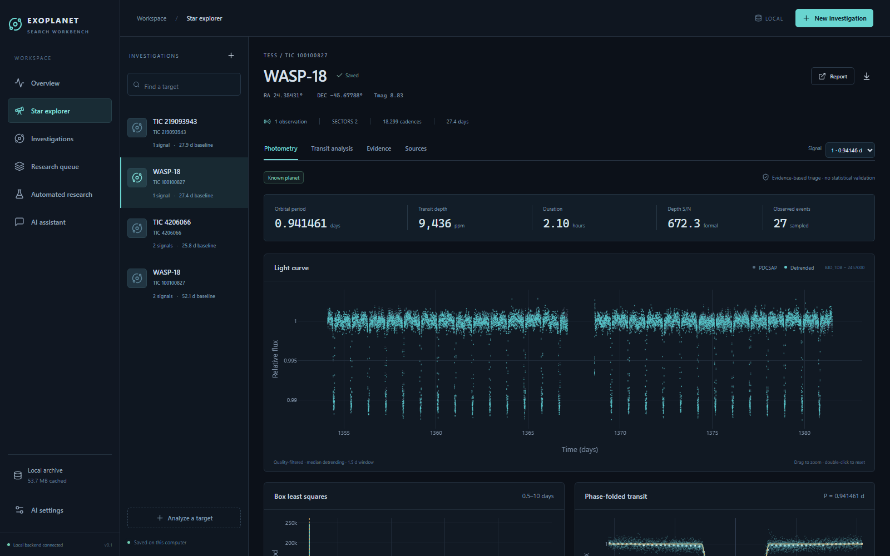
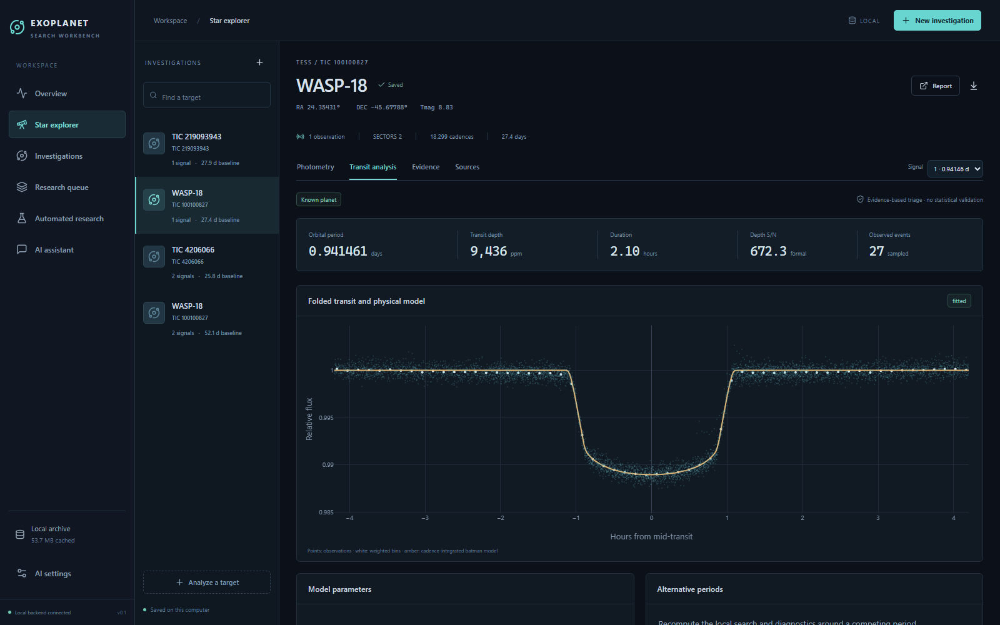

# Exoplanet Search Workbench

A local workbench that searches public NASA TESS, Kepler and K2 light curves
for transiting planets and keeps the evidence needed to check each signal.
The science runs without an AI provider.





## Start

Needs Python 3.11–3.13 and Node.js 20+. Tested on Windows.

```powershell
python run.py
```

This sets up the environment, builds the frontend and opens
<http://127.0.0.1:8765>. The first run takes a few minutes.

## Try it

1. **New investigation → WASP-18 · known positive**, then **Queue analysis**.
2. It should recover **WASP-18 b** at about **0.9415 days** and match it to the
   NASA catalog.
3. Explore the light curve, transit fit and evidence, and download the report
   or reproduction ZIP.

You can also enter any target name, TIC ID or coordinates.

## What it does

- **Downloads** calibrated light curves from MAST and caches them with
  checksums and provenance.
- **Searches** with BLS after detrending, then masks each signal and searches
  again.
- **Checks** each signal with odd/even depths, secondary eclipses,
  per-sector agreement, Gaia neighbors, pixel difference images and injection
  recovery.
- **Fits** transit models with `batman` and cross-checks against NASA
  confirmed planets and TOIs.
- **Exports** reports and reproduction ZIPs with the raw data and a script
  that reruns the analysis.
- **Optional AI:** an assistant or automated research runs can call the same
  tools through OpenAI, Anthropic, Gemini, OpenRouter or a local model, within
  set budgets. Keys are stored in the OS credential store.
- **MCP:** 22 tools for Claude Desktop or other clients. See
  [docs/mcp.md](docs/mcp.md).

## Limits

This is triage, not planet validation.

- Classifications are rule-based, not probabilities.
- There are no false-positive probabilities or calibrated red-noise errors.
- Transit fits are exploratory, with fixed circular orbits and limb darkening.
- Pixel tests can't confirm the host star.
- "Unclassified" doesn't mean "undiscovered."

See [methodology](docs/methodology.md) and [remaining work](docs/improvements.md).

## Tests

```powershell
.venv/Scripts/python -m pytest -q
cd frontend && npx playwright test
```

Data lives in `data/` (or `EXO_DATA_DIR`). The server only listens on
localhost and is single-user.

MIT License.
